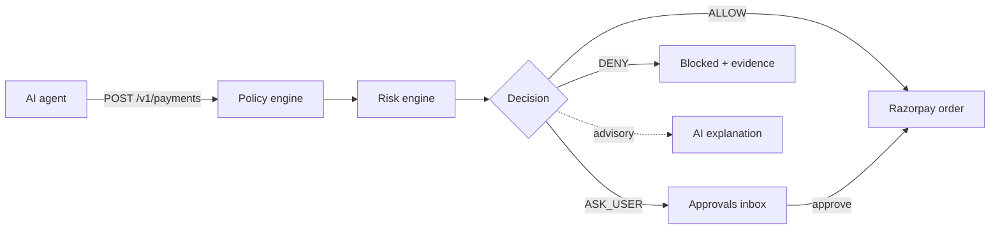

<p align="center">
  
</p>

<h1 align="center">PayTrust AI</h1>

<p align="center"><strong>Payment authorization for AI agents.</strong><br />
Before an agent spends a user's money, PayTrust decides <b>ALLOW</b>, <b>ASK_USER</b> or <b>DENY</b> in milliseconds, with the evidence for every decision.</p>

<p align="center">
  
  
  
  
  
</p>

---

## Why

AI agents can now buy things for people. A confused, buggy or manipulated agent can drain a budget, pay a gambling site, or repeat the same purchase in a loop. PayTrust sits between the agent's intent and the payment rail:



* **Deterministic.** Policy and risk rules decide. The LLM only explains and can never approve money movement.
* **Evidence for everything.** Each decision stores its violations, scored risk factors, counterfactual costs and an audit trail.
* **Safe under load.** A payer's payments are serialized in one transaction, so parallel requests can't jointly exceed a daily limit. Retries are idempotent.

## What's inside

| | |
|---|---|
| **Agent API** | `POST /v1/payments` with a per-agent API key. Returns the decision, reasons, risk factors and simulated counterfactuals. |
| **Approvals** | ASK_USER payments wait in an inbox (reserving their budget) until a reviewer approves or rejects them, or they expire. The agent is notified through a signed callback. |
| **Operator console** | React app: live dashboard, payments with full evidence, approvals, playground, policy editor, agents & keys, audit log, team roles. |
| **Agent Arena** | Simulated honest and malicious agents (runaway loop, budget drain, prompt injection, stolen key) send real traffic through the API. A scorecard shows attacks caught, honest payments blocked, and latency. |
| **ML model** | Advisory fraud model trained on IEEE-CIS (590k real transactions), with a threshold tool showing precision, recall and simulated cost. |
| **Operations** | PostgreSQL + Alembic, Redis rate limits and live feed, Prometheus `/metrics`, `/health` and `/ready`, structured logs with request ids, one Docker image. |

## Run it locally

**Option A — no Docker (SQLite, fastest).** Needs Python 3.12+ and Node 20+.

```bash
# API → http://localhost:8000  (docs at /docs)
cd backend
python -m venv .venv && .venv/Scripts/activate        # macOS/Linux: source .venv/bin/activate
pip install -r requirements-dev.txt
uvicorn app.main:app --reload

# Console → http://localhost:5173  (second terminal)
cd frontend
npm install
npm run dev
```

Sign in with `admin@paytrust.local` / `admin12345` (development defaults; change them via `.env`).

**Option B — production-like (PostgreSQL + Redis).**

```bash
cp .env.example .env          # set SECRET_KEY and ADMIN_PASSWORD
docker compose up --build     # → http://localhost:8000 (console + API on one port)
```

### Try it

1. **Playground** → *Large purchase* → ASK USER → approve it in **Approvals**.
2. **Playground** → *Mislabelled*: the agent says "electronics", but the merchant is a registered gambling site → DENY.
3. **Agent Arena** → *Mixed traffic* → watch the live scorecard.
4. Call the API as an agent: create a key in **Agents & keys**, then

```bash
curl -X POST http://localhost:8000/v1/payments \
  -H "X-API-Key: pt_xxxxxxxx_..." -H "Content-Type: application/json" \
  -d '{"request_id":"order_1001","user_id":1,"merchant_id":1,"merchant_name":"TechMart Electronics","amount":25000,"category":"electronics"}'
```

## Test

```bash
cd backend && pytest                                 # 80 tests: engines, API, concurrency, approvals, Arena
TEST_DATABASE_URL=postgresql+psycopg://... pytest   # the same suite against PostgreSQL
cd frontend && npm run build                         # type-check + production build
```

CI runs the backend suite on SQLite and PostgreSQL, checks that migrations match the models, builds the frontend, and smoke-tests the Docker image.

## Project layout

```
backend/            FastAPI service
  app/domain/       pure decision engines — policy, risk, decision, counterfactuals
  app/services/     evaluation pipeline, approvals, AI, Razorpay, events, rate limits
  app/api/routes/   HTTP endpoints
  app/arena/        Agent Arena personas + runner
  alembic/          database migrations
  tests/
frontend/           React + TypeScript + Tailwind operator console
ml/                 offline IEEE-CIS training and evaluation scripts
docs/               architecture, API guide, deployment
```

## Docs

* [Architecture & decision rules](docs/ARCHITECTURE.md)
* [Agent integration guide](docs/API.md)
* [Deployment](docs/DEPLOYMENT.md)

## Author

**Sanskar** — [@Sanskar1724](https://github.com/Sanskar1724). Built for the Razorpay Buildathon, Track 02: AI Risk Manager.

## License

[MIT](LICENSE)
