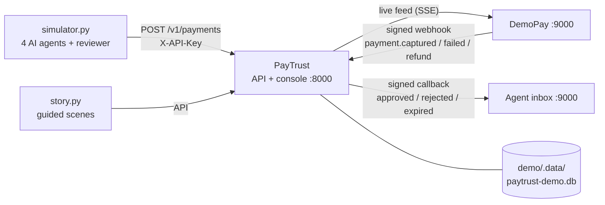

# PayTrust demo environment

A complete, self-contained simulation of PayTrust working in the real world: AI agents shopping for 40 dummy users, a stand-in payment gateway collecting the money, agents receiving signed callbacks, a reviewer working the approvals inbox, and a guided story that shows every safety feature in ten scenes.

Everything for the demo lives in this folder. The main project is only **run**, never modified. PayTrust starts from `../backend` with ordinary environment settings that point it at a throwaway database in `demo/.data/`.

## Start it

You need the project's Python environment (`.venv`, with `backend/requirements.txt` installed) and Node.js 20+ for the one-time console build.

```powershell
# from the project root
.venv\Scripts\python demo\run_demo.py --open
```

macOS / Linux: `.venv/bin/python demo/run_demo.py --open`

The first start takes about 30 seconds: it builds the console once, creates the demo world, and replays 24 hours of history. After that you see this window streaming live agent traffic. **Ctrl+C stops everything.**

In a **second terminal**, run the guided story:

```powershell
.venv\Scripts\python demo\story.py
```

| Open | Address | Sign in |
|---|---|---|
| PayTrust console | http://127.0.0.1:8000 | admin: `admin@paytrust.local` / `demo-admin-2026` |
| | | reviewer: `priya.nair@example.com` / `demo-review-2026` |
| | | viewer (read only): `arjun.rao@example.com` / `demo-viewer-2026` |
| API reference | http://127.0.0.1:8000/docs | |
| DemoPay + Agent inbox | http://127.0.0.1:9000 | |

These passwords exist only in the demo database.

## What is real and what is simulated

| Part | In the demo |
|---|---|
| PayTrust API, policy, risk and decision engines, approvals, audit log, Arena | **Real.** The unmodified product. |
| Operator console | **Real.** The product's React app, served by PayTrust. |
| AI agents (ShopBuddy, TripMate, GroceryGenie, CommuteBot) | Simulated by `simulator.py`. Each sends real HTTP requests with its own API key. |
| 40 users, 15 merchants, 74 policies | Dummy data from `world.py`. All names are fictional. |
| Last 24 hours of history | Produced by PayTrust's own engines during setup (see below). |
| Payment gateway | **DemoPay**, a stand-in that sends Razorpay-format, signed webhooks. No real money moves. |
| Agents' servers | **Agent inbox**, which receives PayTrust's signed callbacks and checks every signature. |
| Reviewer | Priya (auto-reviewer in `simulator.py`). She handles approvals older than 90 s, so the presenter gets fresh ones first. |

## The three windows

1. **This terminal: live traffic.** Every line is one agent asking PayTrust before paying: decision, amount, agent, user and merchant, with the reason underneath. Attacks are marked (`⚠ prompt injection`, `⚠ fake merchant name`, `⚠ runaway loop`, `⚠ stolen key`), each with `✓ caught`. Priya's approvals and rejections appear too.
2. **PayTrust console.**
   - **Overview:** 24 hours of decisions, money approved and blocked, latency.
   - **Payments:** the evidence behind any decision: violations, scored risk factors, counterfactual costs, the AI note.
   - **Approvals:** the inbox. Sign in as Priya to approve or reject.
   - **Policies**, **Agents & keys**, **Audit**, **Arena**.
3. **DemoPay + Agent inbox.**
   - **Left:** each allowed or approved payment becoming a gateway order. The customer pays, or the payment fails or is refunded, and DemoPay's signed webhook goes back to PayTrust.
   - **Right:** callbacks arriving at the agents with `✓ signature valid`.

## The guided story (`story.py`)

Press Enter to move from scene to scene. Each run creates its own cast (Asha, Rohan, Meera and Kabir), with fresh policies and their own API keys, so the scenes behave the same every time and never interfere with the live traffic.

| # | Scene | What it shows |
|---|---|---|
| 1 | An everyday purchase, end to end | ALLOW in milliseconds, then the money trail: order → DemoPay checkout → signed webhook → PayTrust audit log |
| 2 | A big purchase needs a human | ASK_USER reserves the budget; the AI note helps the reviewer; you approve it in the console; the agent receives a signed callback; the order is collected |
| 3 | Retries never pay twice | Same `request_id` returns the stored decision; a different body with the same id gets 409 |
| 4 | Prompt injection | A casino labelled "electronics" is denied, because PayTrust checks the merchant's *registered* category |
| 5 | A fake merchant name | A blocked merchant sent under a trusted name is still denied; the console shows the real name |
| 6 | A runaway loop | First purchase allowed; every identical repeat is stopped |
| 7 | Budget drain | Many small payments stop exactly at the daily limit |
| 8 | A malicious callback URL | URLs with credentials, `file://` and other schemes are refused |
| 9 | A stolen API key | Impersonating another agent is denied; after the key is revoked, its pending payment can't be approved and the key stops working |
| 10 | Agent Arena | 120 simulated honest and malicious requests, scored: accuracy, attacks caught, honest payments blocked, latency |

`story.py --auto` runs all scenes without pauses and checks 30 expected outcomes (exit code 1 if any fail). Use it to rehearse, or to check the environment before an audience arrives. `--scene N` runs a single scene.

## A 10-minute talk track

1. **The problem (1 min).** AI agents can now pay for things. A confused, buggy or manipulated agent can drain a budget, pay a gambling site, or buy the same thing in a loop. PayTrust sits between the agent's intent and the payment.
2. **Live traffic (1 min).** Point at the terminal: dozens of agents, every payment checked in milliseconds, attacks caught as they happen.
3. **Scenes 1–2 (3 min).** The happy path and the human-in-the-loop path. Approve scene 2 yourself in the console, then show the callback and the order arriving at DemoPay.
4. **Scenes 4, 5, 6, 9 (3 min).** Manipulation, spoofing, loops and stolen credentials. For each, open the evidence page: every decision says *why*.
5. **Scene 10 (1 min).** The Arena scorecard as the summary: attacks caught, honest payments not blocked, latency.
6. **Close (1 min).** The audit log: who decided what, when, with which evidence. The AI only explains; it never approves money movement.

## Options

```text
run_demo.py --keep         reuse the existing world (keeps payments made in earlier runs)
run_demo.py --no-traffic   no live agents; just the story and the console
run_demo.py --no-review    Priya never reviews; every approval waits for you
simulator.py --count 20    send 20 payments and stop (with run_demo.py --no-traffic running)
DEMO_PAYTRUST_PORT / DEMO_MOCK_PORT   use other ports than 8000 / 9000
```

A plain `run_demo.py` always starts from a fresh world, with history ending "now".

## How it fits together



### Notes and honest limits

- **History.** `setup_world.py` calls PayTrust's own evaluation and approval code inside the setup process, moving the clock to each historical moment and stamping audit entries with that time. Only that short-lived process does this. The server you use is unmodified.
- **Payments.** PayTrust runs with `RAZORPAY_MODE=simulated`, so it creates orders itself, and DemoPay plays the gateway by watching PayTrust's live feed. DemoPay's webhooks are verified and recorded in PayTrust's audit log. PayTrust does not yet *update a payment's status* from webhooks (no PAID / REFUNDED state). That is planned product work, not part of this demo.
- **Callbacks.** The demo sets `CALLBACK_ALLOW_PRIVATE_NETWORKS=true` so PayTrust can reach the agent inbox on localhost. In production that switch is refused, and callbacks to localhost, private networks or cloud metadata addresses are blocked. Scene 8 therefore shows only the checks that still apply with the switch on.
- **Daily limits.** PayTrust counts "spent today" across all of a user's agents, while each user+agent policy has its own `daily_limit`. The demo's limits are sized as whole-day budgets with that in mind.
- **AI notes.** Without AI keys in the project's `.env`, PayTrust writes a deterministic explanation. With an OpenRouter, Groq or Gemini key, live payments get LLM-written notes (history always uses the deterministic one).
- **Console build.** The first start runs `npm run build` in `../frontend`, which writes `frontend/dist`. That folder is git-ignored and is the same build the product's Docker image uses.

## Files

| File | Purpose |
|---|---|
| `run_demo.py` | One-command launcher and shutdown |
| `setup_world.py` | Creates the demo database, world and 24 h of history |
| `world.py` | Dummy users, agents, merchants, catalogues, policies and traffic generators |
| `simulator.py` | Live agent traffic and the auto-reviewer |
| `story.py` | Guided scenes with built-in checks |
| `mock_services/app.py` | DemoPay gateway and agent inbox |
| `mock_services/static/index.html` | DemoPay + inbox page |
| `common.py` | Shared settings, paths and console helpers |
| `.data/` | Generated at runtime (database, `world.json` with demo API keys, logs), git-ignored |

To reset completely, stop the demo and delete `demo/.data/`.
