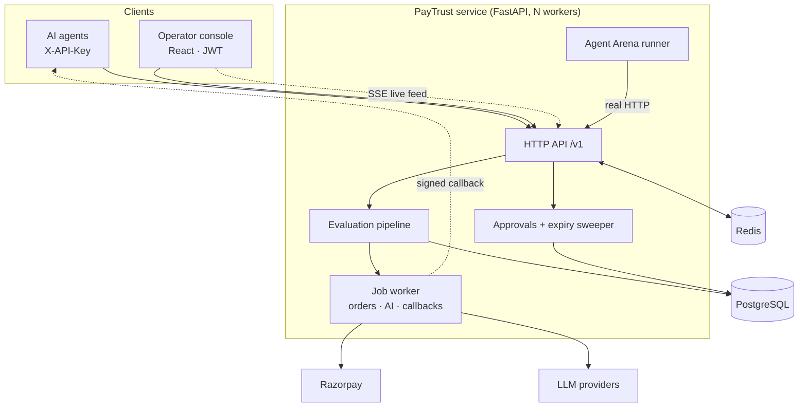
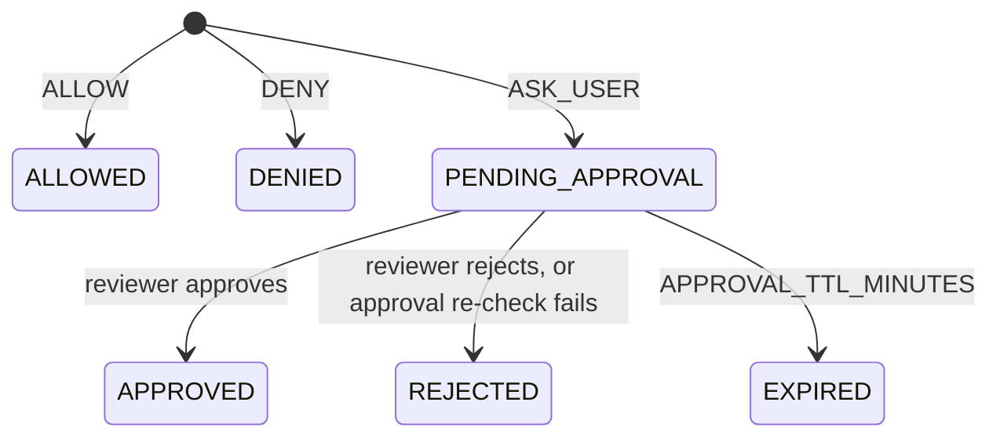

# Architecture

## Components

One image serves the API and the built console from the same origin. Every piece of shared state lives in PostgreSQL. Redis holds rate-limit counters and fans out live events across workers and instances. Without Redis, both fall back to in-process versions, which is fine for a single instance.

## The evaluation pipeline

`backend/app/services/evaluation.py` is the only code path that makes a decision. The agent API, the Playground and the Arena all call it.

1. **Idempotency.** If `request_id` already exists with the same body hash, return the stored decision (HTTP 200). With a different body, return 409.
2. **Lock the payer.** `SELECT … FOR UPDATE` on the user row. On SQLite, every transaction is `BEGIN IMMEDIATE`. Concurrent payments for one payer run one at a time.
3. **Gather context, excluding this payment.** Budget used today (in `SPEND_TIMEZONE`, counting ALLOWED + APPROVED + PENDING_APPROVAL), attempts in the last hour, identical payments in the last 10 minutes, and the payer's and merchant's history.
4. **Policy → Risk → Decision → Counterfactuals.** These are the pure functions in `app/domain/`.
5. **Write** the payment, its evidence, an audit event and its follow-up **jobs** in the same transaction: an `order.create` job for ALLOWED payments, an `ai.investigate` job for pending ones. Any failure rolls back and returns an error, never a decision (fail-closed).
6. **After commit:** publish to the live feed and wake the job worker.

### Background jobs (`app/services/jobs.py`)

Follow-up work is a transactional outbox: a `jobs` row is committed together with the change that needs it, so it exists exactly when the decision does, and survives a crash or restart.

| Job | Created when | On final failure |
|---|---|---|
| `order.create` | a payment is ALLOWED, or approved (then it also queues the callback, so the callback carries the order) | the payment gets `order.status = "error"`, audited `ORDER_FAILED`; the agent is still notified |
| `ai.investigate` | a payment goes to ASK_USER | nothing (the explainer has a deterministic fallback) |
| `callback.notify` | a pending payment is approved, rejected, blocked at approval, or expires | `CALLBACK_FAILED` after `CALLBACK_MAX_ATTEMPTS`; an unsafe URL is `CALLBACK_BLOCKED` at once |

A worker (in the web process, or separately with `python -m app.cli worker`) claims due jobs with a compare-and-set update and holds a lease (`JOB_LEASE_SECONDS`). If a worker dies mid-job, the lease runs out and any worker retries it. The attempt number fences each claim, so a late, superseded run can't overwrite a newer outcome. Failures retry with exponential backoff and jitter (`JOB_BACKOFF_BASE_SECONDS`, doubling up to `JOB_BACKOFF_MAX_SECONDS`). After `JOB_MAX_ATTEMPTS` the job becomes `DEAD` (the dead-letter queue), audited as `JOB_DEAD`. Dead jobs show up in the console under **Background jobs** (with a red count in the menu) and through `GET /v1/jobs?status=DEAD`, and an admin can retry them (`POST /v1/jobs/{id}/retry`). A retried order that succeeds replaces the payment's error marker and sends the agent a second callback with the order. Handlers are idempotent because delivery is at-least-once.

### Policy (`app/domain/policy.py`)

| Violation | Rule |
|---|---|
| `max_transaction_exceeded` | amount > max per payment |
| `daily_limit_exceeded` | used today + amount > daily limit |
| `category_blocked` / `category_not_allowed` | category the agent claims vs. the policy lists |
| `merchant_category_blocked` | the merchant's **registered** category is blocked, whatever the agent claims |
| `merchant_blocked` / `merchant_not_allowed` | merchant lists, matched on the merchant's id or **registered** name (case-insensitive), never the name the agent sends |
| `missing_user`, `missing_policy`, `missing_merchant`, `unauthorized_agent`, `agent_key_mismatch`, `agent_unauthorized` | identity and mandate |

An amount above `approval_threshold` sets `requires_approval`. That is not a violation.

### Risk (`app/domain/risk.py`)

Points per factor, capped at 100. Any critical factor lifts the score to at least 65. Levels: LOW ≤ 30 < MEDIUM ≤ 60 < HIGH ≤ 80 < CRITICAL.

| Factor | Points |
|---|---|
| Amount ≥ 15k / 30k / 50k | 5 / 12 / 20 |
| Budget use after this payment ≥ 50% / 70% / 90% | 6 / 12 / 20 |
| High-risk category (claimed) / high-risk merchant / high merchant tier | 25 / 20 / 12 |
| Claimed category ≠ merchant's registered category | 12 |
| Claimed merchant name clearly ≠ registered name (abbreviations are fine) | 35 |
| First payment to this merchant | 10 |
| Policy violations | 15–25 each |
| Agent not authorized | 20–25 |
| ≥ 3 / 5 / 10 attempts in the last hour | 6 / 12 / 20 |
| Identical payment in the last 10 min: 1 / ≥ 3 | 35 / 65 |
| Little history with a large amount | 10–12 |

### Decision (`app/domain/decision.py`)

1. Any violation → **DENY**
2. HIGH or CRITICAL risk → **DENY**
3. MEDIUM risk → **ASK_USER**
4. LOW risk, amount above approval threshold → **ASK_USER**
5. Otherwise → **ALLOW**

## Payment lifecycle

A pending payment reserves its amount, so approving it can never overspend. Rejecting it or letting it expire frees the reservation.

Approving re-checks the mandate at the moment money would move. The agent must still be active, the API key that submitted the payment must not be revoked, the user and merchant must still exist, and the **current** policy must still allow the payment. That includes the merchant's current registered category and the day's budget, not counting this payment's own reservation twice. Risk is not re-scored, because overriding risk is the reviewer's job. If any check fails, the payment becomes `REJECTED` by `system` with the reasons in `review_note`, the event is audited as `APPROVAL_BLOCKED`, the agent is notified, and the reviewer gets HTTP 409.

## Security

* Agent keys `pt_<prefix>_<secret>`: only a SHA-256 of the secret is stored, the key is shown once, and it can be revoked. A key can only act as its own agent.
* Operators: bcrypt passwords, short-lived JWTs, and roles `viewer` < `reviewer` < `admin`.
* Rate limits per key, per operator and per login email.
* Razorpay webhooks are verified with HMAC over the raw body and are idempotent by event id. Outbound callbacks are signed with the agent's webhook secret.
* Logs redact keys, tokens and secrets. In production, startup is refused if the configuration is unsafe (default secrets, wildcard CORS, SQLite).

## Agent Arena

Each run creates its own payers, a standard policy and one API key per simulated agent. It sends requests over real HTTP and scores every decision against that request's ground truth. Arena traffic is tagged `source=arena` and kept out of the dashboard and approvals inbox. Its pending payments are closed and its keys revoked when the run ends.

The scorecard measures whether the rules behave as designed against known attack patterns, plus real latency and throughput. It is not a claim about real-world fraud rates.
