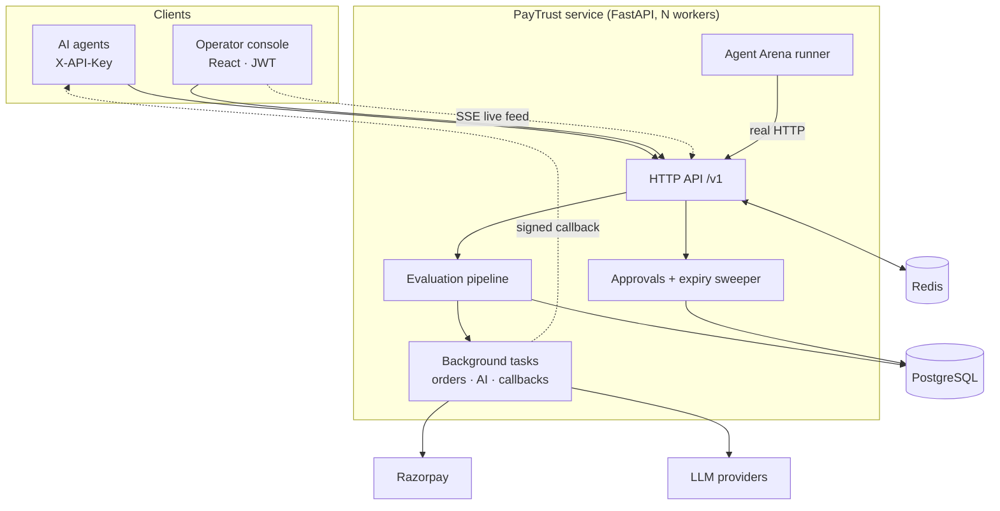
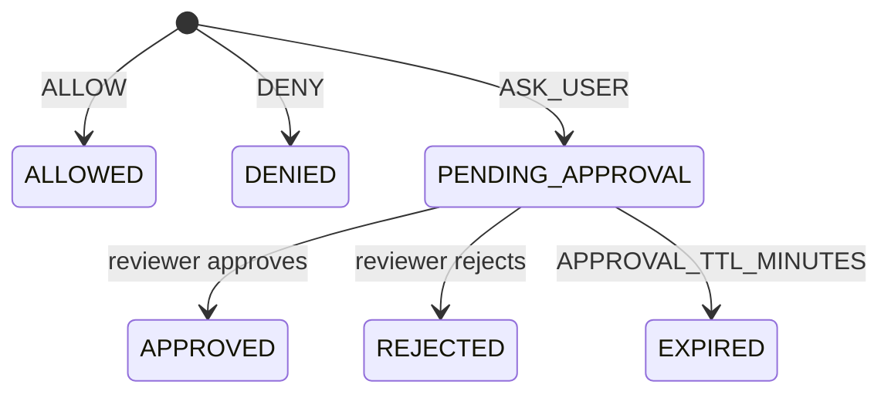

# Architecture

## Components

One image serves the API and the built console from the same origin. Every piece of shared state lives in PostgreSQL. Redis holds rate-limit counters and fans out live events across workers and instances. Without Redis, both fall back to in-process versions, which is fine for a single instance.

## The evaluation pipeline

`backend/app/services/evaluation.py` is the only code path that makes a decision. The agent API, the Playground and the Arena all call it.

1. **Idempotency.** If `request_id` already exists with the same body hash, return the stored decision (HTTP 200). With a different body, return 409.
2. **Lock the payer.** `SELECT … FOR UPDATE` on the user row. On SQLite, every transaction is `BEGIN IMMEDIATE`. Concurrent payments for one payer run one at a time.
3. **Gather context, excluding this payment.** Budget used today (in `SPEND_TIMEZONE`, counting ALLOWED + APPROVED + PENDING_APPROVAL), attempts in the last hour, identical payments in the last 10 minutes, and the payer's and merchant's history.
4. **Policy → Risk → Decision → Counterfactuals.** These are the pure functions in `app/domain/`.
5. **Write** the payment, its evidence and an audit event in the same transaction. Any failure rolls back and returns an error, never a decision (fail-closed).
6. **After commit:** publish to the live feed. In the background, create a Razorpay order for ALLOWED payments and write an AI explanation for pending ones.

### Policy (`app/domain/policy.py`)

| Violation | Rule |
|---|---|
| `max_transaction_exceeded` | amount > max per payment |
| `daily_limit_exceeded` | used today + amount > daily limit |
| `category_blocked` / `category_not_allowed` | category the agent claims vs. the policy lists |
| `merchant_category_blocked` | the merchant's **registered** category is blocked, whatever the agent claims |
| `merchant_blocked` / `merchant_not_allowed` | merchant lists |
| `missing_user`, `missing_policy`, `missing_merchant`, `unauthorized_agent`, `agent_key_mismatch`, `agent_unauthorized` | identity and mandate |

An amount above `approval_threshold` sets `requires_approval`. That is not a violation.

### Risk (`app/domain/risk.py`)

Points per factor, capped at 100. Any critical factor lifts the score to at least 65. Levels: LOW ≤ 30 < MEDIUM ≤ 60 < HIGH ≤ 80 < CRITICAL.

| Factor | Points |
|---|---|
| Amount ≥ 15k / 30k / 50k | 5 / 12 / 20 |
| Budget use after this payment ≥ 50% / 70% / 90% | 6 / 12 / 20 |
| High-risk category (claimed) / high-risk merchant / high merchant tier | 25 / 20 / 12 |
| Claimed category ≠ merchant's registered category | 12 |
| First payment to this merchant | 10 |
| Policy violations | 15–25 each |
| Agent not authorized | 20–25 |
| ≥ 3 / 5 / 10 attempts in the last hour | 6 / 12 / 20 |
| Identical payment in the last 10 min: 1 / ≥ 3 | 35 / 65 |
| Little history with a large amount | 10–12 |

### Decision (`app/domain/decision.py`)

1. Any violation → **DENY**
2. HIGH or CRITICAL risk → **DENY**
3. MEDIUM risk → **ASK_USER**
4. LOW risk, amount above approval threshold → **ASK_USER**
5. Otherwise → **ALLOW**

## Payment lifecycle

A pending payment reserves its amount, so approving it can never overspend. Rejecting it or letting it expire frees the reservation.

## Security

* Agent keys `pt_<prefix>_<secret>`: only a SHA-256 of the secret is stored, the key is shown once, and it can be revoked. A key can only act as its own agent.
* Operators: bcrypt passwords, short-lived JWTs, and roles `viewer` < `reviewer` < `admin`.
* Rate limits per key, per operator and per login email.
* Razorpay webhooks are verified with HMAC over the raw body and are idempotent by event id. Outbound callbacks are signed with the agent's webhook secret.
* Logs redact keys, tokens and secrets. In production, startup is refused if the configuration is unsafe (default secrets, wildcard CORS, SQLite).

## Agent Arena

Each run creates its own payers, a standard policy and one API key per simulated agent. It sends requests over real HTTP and scores every decision against that request's ground truth. Arena traffic is tagged `source=arena` and kept out of the dashboard and approvals inbox. Its pending payments are closed and its keys revoked when the run ends.

The scorecard measures whether the rules behave as designed against known attack patterns, plus real latency and throughput. It is not a claim about real-world fraud rates.
